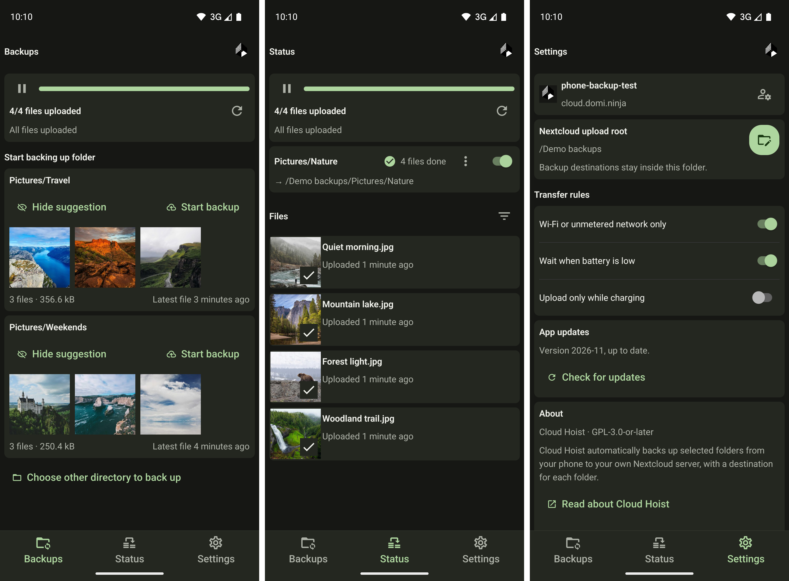

# Cloud Hoist
## Sync Android files to Nextcloud

An Android app that uploads selected phone folders to Nextcloud. Independent from Nextcloud GmbH. Requires Android 10 or newer and one Nextcloud account.

This app is for people who want to back up some of the data on their android phones, without using google drive. It only does one-way backups. Files stay on the phone, and deleting a local file leaves its uploaded copy alone. 

This app will never edit or delete files on your nextcloud. It might move them around, or make duplicates, but you should not loose any data. However, having good backups of all the digital things closest to your heart is essential. 

> Take a second to plug in a USB disk and do this right now, or regret it later, when enthropy or human fallability strikes :)

## Installation

Download [Cloud Hoist 2026-12 beta](https://github.com/domi-ninja/cloud-hoist-webdav-auto-uploader/releases/download/beta-2026-12/cloud-hoist-2026-12.apk), or see [GitHub Releases](https://github.com/domi-ninja/cloud-hoist-webdav-auto-uploader/releases) for all versions. Install the signed APK over an existing installation to keep accounts, settings, and history.

## Backups screen

Here, we can add folders on our phone we want to upload to the nextcloud automatically. Each phone folder gets its own destination. 

Folders containing photos or videos appear as suggestions, like `Pictures/Travel` in the left-hand screenshot above. The screen shows two suggestions at a time, with previews of the files inside.

If you want to back up this suggested folder, click `Start backup`. This will lead you to a screen where you can choose where on your nextcloud you want to have these backups. By default, everything uploaded by this app will live in `/Phone Uploads` on your nextcloud. You can change this folder in the `Settings`.

Start with your camera photos, then add other folders you want to keep. Tap `Hide suggestion` to dismiss a folder and make room for another suggestion. You can restore dismissed suggestions from `Hidden folders` at the bottom of the screen.

For folders that are not automatically found, use the `Choose other directory to back up` button and find the folder on your phone. For example, if you use Signal messenger, you can configure on-device backups and have it put your message history backups into a folder. You can then select this folder and sync it to your nextcloud.

## Status 

This screen shows configured backups. You can turn them off temporarily, change or delete them. If you edit a backup and change the destination folder on nextcloud, the app will ask you if you want to move the existing files on the nextcloud. I hope this will help you deal with messy situations.

## Settings 

Uploads can wait for Wi-Fi, charging, or enough battery. 

Beta testers of the app will be notified of updates and can download the APK manually.  

---

## License

[GPL-3.0-or-later](LICENSE). Dependencies and retained scaffold assets keep their [third-party notices](THIRD_PARTY_NOTICES.md).
